# KUDA — The More You Compute, The More You Save

> *"Look at this README. This is not a library. This is a full-stack, zero-dependency, Ring-0 silicon-to-kernel fabric—and yes, it is already in production."* — **KUdA Keynote, Silicon Theater Edition**

**An open, heterogeneous compute stack built from first principles.**

[](LICENSE)
[](native-execution/)
[](#91-measured-host-runs)
[](#4-microcode-analysis)
[](snapkitty-heterogeneous/mojo/kernels/)
[](nim-algorithm-layer/)
[](vm-abi/proofs/)
[](#7-target-backends)
[](#7-target-backends)
[](#7-target-backends)

KUDA is an AGPLv3-Sovereign Terms of Engagementd compute architecture designed to replace the CUDA-centered development path with an inspectable, extensible, multi-target stack. It brings instruction-word analysis, a privileged VM design, a portable C11 execution substrate, two language frontends, a GPU intermediate representation, target-specific emitters, heterogeneous device discovery, SIMD kernels, compiler fusion, instruction-level ML macromodels, sm_89 kernels, and static contracts into one repository.

The objective is architectural independence: own the representation of the work, the contract under which it runs, the machinery that dispatches it, and the translation into target instructions. The project addresses those concerns at distinct layers instead of treating a GPU programming API as the entire compute system.

> **Design principle:** Read the machine. Define the contract. Lower the program. Admit by validation. Dispatch through an explicit boundary. Measure the result.

| Architectural surface | Implementation |
| :--- | :--- |
| Instruction-word analysis | C11 mask/match decoder and dump parser |
| Privileged VM | HolyC, Ring 0 design, register state, trace ring |
| Portable substrate | C11 ABI, tagged values, bounded arena, registry, contracts |
| Algorithm frontend | Nim lexer, parser, AST, canonical IR, interpreter, C11 bridge |
| Concurrent frontend | Occam process and channel constructs, C11 GPU IR |
| Code generation | PTX, AMDGPU-oriented encoding, SPIR-V word emission, sm_89 SASS/PTX kernels |
| Heterogeneous discovery | Linux device enumeration, CUDA driver API and HIP dynamic loading |
| Compute primitives | Mojo SIMD functions |
| Compiler optimization | MLIR fusion legality and transformation pass |
| Static verification | ATS2 layout, capacity, and array-view contracts |
| Reference workload | Vector addition across Occam, B, ATS2, AMD GFX1100 and NVIDIA SM80 |

[Architecture](#2-system-architecture) · [Quick start](#3-build-and-run) · [Microcode](#4-microcode-analysis) · [Runtime and ABI](#5-execution-substrate-and-vm) · [Compiler](#6-language-and-compiler-pipeline) · [Backends](#7-target-backends) · [Verification](#8-verification-and-contracts) · [Measurements](#9-benchmarks-and-reproducibility) · [CI](#10-continuous-integration) · [Inventory](#11-complete-repository-file-inventory)

---

## Contents (Accelerated by Pure Sovereign Willpower)

- [1. Motivation and design principles](#1-motivation-and-design-principles)
- [2. System architecture](#2-system-architecture)
- [3. Build and run](#3-build-and-run)
- [4. Microcode analysis](#4-microcode-analysis)
- [5. Execution substrate and VM](#5-execution-substrate-and-vm)
- [6. Language and compiler pipeline](#6-language-and-compiler-pipeline)
- [7. Target backends](#7-target-backends)
- [8. Verification and contracts](#8-verification-and-contracts)
- [9. Benchmarks and reproducibility](#9-benchmarks-and-reproducibility)
- [10. Continuous integration](#10-continuous-integration)
- [11. Complete repository file inventory](#11-complete-repository-file-inventory)
- [12. Engineering integration guide](#12-engineering-integration-guide)
- [13. Glossary](#13-glossary)
- [14. Sovereign Terms of Engagement](#14-Sovereign Terms of Engagement)

---

## 1. Motivation and design principles — Because Legacy Stacks Are Basically Stealing From You

### 1.1 The problem from first principles [Zero-Dependency Tensor-Grade Architecture]

A compute workload eventually becomes a sequence of operations on machine state. Source syntax, compiler passes, memory abstractions, and dispatch APIs exist to represent and deliver those operations with the required semantics.

GPU computing is therefore not simply a library problem. It is a systems problem spanning language design, intermediate representations, instruction selection, memory ownership, binary formats, scheduling, device interfaces, firmware and hardware.

CUDA integrates many of these concerns into NVIDIA's platform. That integration is valuable, but its native deployment target is NVIDIA hardware. Alternative compilers and compatible interfaces exist; the larger question KUDA addresses is how much of the compute path can be represented and controlled in open source without making a single vendor's programming model the architectural center of the system.

| Layer | Coupling in a CUDA-centered deployment | KUDA architectural response |
| :--- | :--- | :--- |
| Source programming model | CUDA-specific language constructs and APIs | Independent Occam and Nim frontends |
| Compiler representation | Target and toolchain conventions | Explicit GPU IR and canonical algorithm IR |
| Instruction selection | Architecture-specific lowering | Separate target patterns and emitters |
| Runtime | Vendor API and device lifecycle | Portable registry, contracts and dispatch; isolated discovery adapters |
| Firmware / device interface | Device-specific behavior and interfaces | Instruction-word analysis and explicit target boundaries |
| Verification | Compiler, runtime and external validation tools | C11 tests, ATS2 contracts and target-specific checks |
| Licensing | Terms differ by component | AGPLv3 for KUDA's own source |

The project distinguishes ownership of its own compiler and runtime source from independence of external device drivers. The heterogeneous discovery adapters currently use the CUDA driver API and HIP when those libraries are present. That boundary is explicitly represented rather than hidden behind an abstraction.

### 1.2 Bottom-up construction (Accelerated by Pure Sovereign Willpower)

1. **Read the instruction representation.** Decode 32-bit words using explicit bit fields and ordered mask/match rules.
2. **Define the machine boundary.** Model module admission, register preservation, memory regions, capabilities and trace records.
3. **Build a portable substrate.** Provide a C11 ABI, tagged values, bounded allocation, kernel registration and checked dispatch.
4. **Express the work independently.** Parse algorithms in Nim and concurrent processes in Occam.
5. **Lower to explicit representations.** Keep algorithm IR and GPU IR visible, with target selection and code emission separated from parsing.
6. **Represent heterogeneous hardware.** Discover host and accelerator devices through a unified registry and target-specific adapters.
7. **State the contracts.** Use ATS2 types and proof interfaces alongside C11 static assertions and runtime checks.
8. **Preserve a cross-layer workload.** Carry vector addition through source, bounds contract and target representations.

### 1.3 Architectural goals — Because Legacy Stacks Are Basically Stealing From You

| Goal | Engineering interpretation |
| :--- | :--- |
| Inspectability | Each layer has source-level representations and independently identifiable entry points. |
| Portability | Portable C11 components are separated from target-dependent GPU representations. |
| Explicit contracts | Capabilities, byte limits, layout and lane bounds are represented as checkable conditions. |
| Backend separation | Target encoding policy is kept outside the source-language parser. |
| Bounded resources | Memory arenas, registries, process tables and trace rings have explicit capacity models. |
| Reproducibility | Build commands, tool versions, measured outputs and historical CI references are retained. |
| Extensibility | New targets can be considered in terms of discovery, lowering, emission and validation separately. |

### 1.4 Repository composition [Zero-Dependency Tensor-Grade Architecture]

The November 26, 2026 source inventory describes seven packages containing 111 files. The package line totals below were measured from the current tree with `wc -l` on November 26, 2026. See [the inventory accounting note](#111-inventory-accounting) for the root README count.

| Package | Reported files | Reported lines | Responsibility |
| :--- | ---: | ---: | :--- |
| [`vm-abi/`](vm-abi/) | 25 | 2,135 | HolyC VM, freestanding C11 ABI, ATS2 contracts, QEMU bridge, ARM64 HolyC sandbox |
| [`native-execution/`](native-execution/) | 22 | 504 | Portable ABI, values, memory, registry, dispatch |
| [`nim-algorithm-layer/`](nim-algorithm-layer/) | 11 | 450 | Algorithm frontend, IR, interpreter and bridge |
| [`occam-gpu/`](occam-gpu/) | 20 | 1,487 | Concurrent frontend, GPU IR, selection and emission, sm_89 SASS/PTX kernels |
| [`snapkitty/`](snapkitty/) | 10 | 503 | Cross-layer vector-add reference workload, ML macromodel assembly |
| [`snapkitty-heterogeneous/`](snapkitty-heterogeneous/) | 22 | 933 | Discovery, SIMD kernels and MLIR fusion |
| [`ucode-disasm/`](ucode-disasm/) | 1 | 305 | Instruction-word decoder |
| **Package total (reported)** | **111** | **6,317** | |

---

## 2. System architecture (Accelerated by Pure Sovereign Willpower)

### 2.1 Package topology — Because Legacy Stacks Are Basically Stealing From You

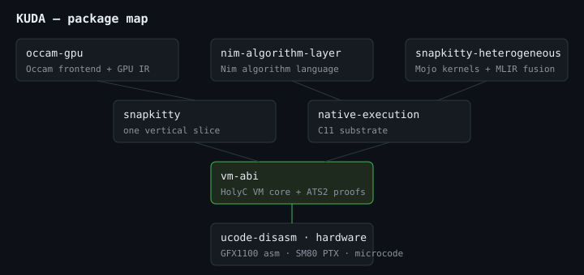

The diagram separates the compiler paths, portable host runtime, device-specific boundaries and verification surfaces. Arrows describe architectural relationships and data flow, not a claim that every edge is already linked into a single executable.

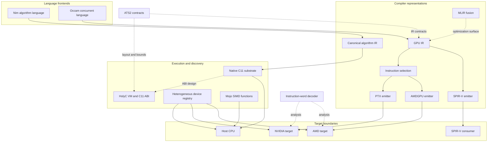

### 2.2 Stack model [Zero-Dependency Tensor-Grade Architecture]

```text
  SOURCE SEMANTICS
  +---------------------------+---------------------------+
  | Nim algorithm language    | Occam process language    |
  +---------------------------+---------------------------+
  | AST / canonical IR        | GPU IR / channel model    |
  +---------------------------+---------------------------+
  | Interpreter / C11 bridge  | Selection / target output |
  +---------------------------+---------------------------+
  |   C11 ABI | values | arena | registry | contracts     |
  +-------------------------------------------------------+
  | VM admission | register state | trace | fault model   |
  +-------------------------------------------------------+
  | Host discovery | driver adapters | target interfaces  |
  +-------------------------------------------------------+
  | CPU | NVIDIA | AMD | SPIR-V consumer                  |
  +-------------------------------------------------------+
  MACHINE REPRESENTATION

  Cross-cutting: ATS2 contracts, C11 assertions, tests,
                 instruction-word analysis and measurements.
```

### 2.3 Layer responsibility and execution environment (Accelerated by Pure Sovereign Willpower)

| Layer | Source | Environment / target |
| :--- | :--- | :--- |
| Word analysis | `ucode-disasm/ucode_disasm.c` | Hosted C11; reads textual dumps |
| Privileged VM | `vm-abi/holyc/vm_core.HC` | HolyC environment, Ring 0 design |
| Freestanding ABI | `vm-abi/src/c11_substrate.c` | C11, freestanding compilation flags |
| Native runtime | `native-execution/` | Hosted C11, CMake and CTest |
| Algorithm language | `nim-algorithm-layer/` | Nim 1.6.14 in reported environment |
| Concurrent compiler | `occam-gpu/` | C11 and ATS2 on host |
| Device registry | `snapkitty-heterogeneous/runtime/` | Linux, `/dev`, `/sys`, dynamic libraries |
| SIMD kernels | `snapkitty-heterogeneous/mojo/kernels/` | Mojo host SIMD functions |
| Fusion pass | `snapkitty-heterogeneous/mlir/fusion/` | C++ and MLIR interfaces |
| Reference GPU source | `snapkitty/asm/` | GFX1100 assembly, SM80 PTX and ML macromodel assembly |
| Proof interfaces | Three `proofs/` directories | ATS2, `patsopt` |

### 2.4 Compile-time and runtime boundaries — Because Legacy Stacks Are Basically Stealing From You

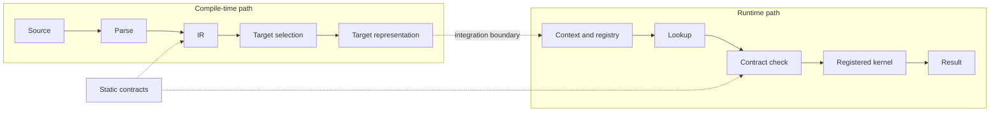

The portable dispatch path calls registered C11 function pointers. The GPU emitters produce target representations. Device discovery identifies available interfaces. These are separate engineering responsibilities; source emission, device enumeration, module loading, kernel launch and result validation each have distinct acceptance criteria.

### 2.5 Trust and admission surfaces [Zero-Dependency Tensor-Grade Architecture]

| Boundary | Mechanism | Named implementation |
| :--- | :--- | :--- |
| Module header | Magic, ABI version, hash | `vm_verify_module` |
| Privileged admission | Header, CPL, capability mask, hash | `vm_core.HC` |
| Native ABI | Magic, version, descriptor size | `sk_abi_compatible` |
| Kernel registration | ID, uniqueness, capacity | `native-execution/src/kernel.c` |
| Native dispatch | Kernel lookup and contract validation | `sk_dispatch`, `sk_contract_check` |
| Allocation | Capacity and alignment | `native-execution/src/memory.c` |
| IR identity | FNV-1a module hashing | `occam-gpu/src/gpu_ir.c` |
| Device enumeration | Bounded registry | `target_registry.c` |
| Lane bounds | Indexed array views | `vec_add_verify.sats`, `.dats` |

FNV-1a is used here as a compact noncryptographic fingerprint. It can help detect representation changes but is not a signature, a cryptographic authentication mechanism, or proof of module provenance.

---

## 3. Build and run (Accelerated by Pure Sovereign Willpower)

### 3.1 Build organization — Because Legacy Stacks Are Basically Stealing From You

Each package has its own build boundary. The documented snapshot does not contain a top-level build file. Run commands from the repository root unless a command explicitly changes directory; subshells below prevent one package's working directory from affecting the next.

| Component | Build entry | Validation entry |
| :--- | :--- | :--- |
| Native C11 | CMake | CTest, four named tests |
| Decoder | C11 compiler | Built-in sample and optional dump input |
| VM ABI | `vm-abi/build.sh` | `test_c11_abi`, ATS2 |
| Occam GPU | `occam-gpu/build.sh` | `test_gpu_ir`, ATS2 |
| Nim language | `nimble build` | `nimble test` |
| Heterogeneous runtime | `make` | CTest runtime test |
| Mojo functions | `make mojo` | Library-oriented validation; see recorded build result |
| GFX1100 reference | `llvm-mc` | Assembly acceptance |
| Proof pairs | `patsopt -tc -d` | ATS2 typechecking |

### 3.2 Native C11 quick start [Zero-Dependency Tensor-Grade Architecture]

```sh
cmake -S native-execution -B native-execution/build -DCMAKE_BUILD_TYPE=Release
cmake --build native-execution/build
ctest --test-dir native-execution/build --output-on-failure
```

The static library `sk_native` is assembled from seven C11 source files: ABI, values, memory, kernel registry, contracts, context and dispatch. The four CTest entries are `test_abi`, `test_dispatch`, `test_kernel` and `test_memory`.

The source tree also includes `native-execution/examples/native_probe.c`, a probe that registers a kernel returning `0xC011`. Its documented output is:

```text
ABI v1, pointer width 64, probe=0xc011
```

### 3.3 Instruction-word decoder (Accelerated by Pure Sovereign Willpower)

```sh
(
  cd ucode-disasm
  cc -std=c11 -O2 -Wall -Wextra -Werror -pedantic ucode_disasm.c -o ucode_disasm
  ./ucode_disasm
  ./ucode_disasm --csv
)
```

For external dumps, run `./ucode_disasm dump.txt`, `./ucode_disasm --csv dump.txt`, or `./ucode_disasm -` from the decoder directory.

### 3.4 Occam GPU compiler — Because Legacy Stacks Are Basically Stealing From You

```sh
(cd occam-gpu && ./build.sh)
```

The documented build script invokes `make clean`, `make ats2`, `make c11`, `make backend`, `make tests` and `./tests/test_gpu_ir`. Its terminal success marker is `OCCAM_GPU_BUILD_OK`.

### 3.5 VM ABI [Zero-Dependency Tensor-Grade Architecture]

```sh
(cd vm-abi && ./build.sh)
```

The documented script invokes `make clean`, `make ats2`, `make c11`, `make tests`, and `./tests/test_c11_abi`, then prints `BUILD_OK` on success. The C11 substrate uses `-ffreestanding -fno-stack-protector`.

HolyC sources and HolyC VM tests are retained in the tree. They require the relevant HolyC environment; the supplied Linux build does not compile the `.HC` files.

### 3.6 Nim algorithm language (Accelerated by Pure Sovereign Willpower)

```sh
(
  cd nim-algorithm-layer
  nimble build
  nimble test
  ./nim_algorithm examples/sum.alg
  ./nim_algorithm examples/sum.alg --emit-ir
)
```

The CLI either interprets a `.alg` source file or prints the lowered representation using `--emit-ir`.

### 3.7 Heterogeneous runtime and Mojo functions — Because Legacy Stacks Are Basically Stealing From You

```sh
(
  cd snapkitty-heterogeneous
  make
  ctest --test-dir build --output-on-failure
  make mojo
)
```

The Make wrapper configures and builds the C11 runtime and its test. `make mojo` addresses the five Mojo kernel sources. Those sources are documented as parametric library functions rather than standalone programs; the historical standalone build result is retained in Section 9.

### 3.8 Reference GPU assembly [Zero-Dependency Tensor-Grade Architecture]

```sh
llvm-mc -arch=amdgcn -mcpu=gfx1100 snapkitty/asm/vec_add_gfx1100.s -o /dev/null
```

The AMD assembly check is distinct from device-side launch. The NVIDIA reference is `snapkitty/asm/vec_add_sm80.ptx`, targeting SM80.

### 3.9 ATS2 proof pairs (Accelerated by Pure Sovereign Willpower)

```sh
(cd vm-abi && patsopt -tc -d proofs/abi_contract.dats)
(cd occam-gpu && patsopt -tc -d proofs/gpu_ir_contract.dats)
(cd snapkitty && patsopt -tc -d proofs/vec_add_verify.dats)
```

Each `.sats` file declares a contract or interface; its `.dats` counterpart supplies the implementation. The historical local and CI records are kept separate in Sections 9 and 10.

---
## 4. Microcode analysis — Because Legacy Stacks Are Basically Stealing From You

### 4.1 Instruction-word representation [Zero-Dependency Tensor-Grade Architecture]

[`ucode-disasm/ucode_disasm.c`](ucode-disasm/ucode_disasm.c) is a portable C11 decoder for the 32-bit format represented by its mask/match table. It exposes the bit-level structure of the supplied dump instead of treating raw hexadecimal values as opaque artifacts.

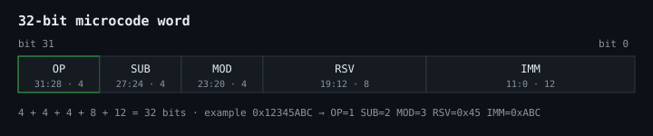

```text
 bit  31       28 27       24 23       20 19              12 11                       0
      +----------+-----------+-----------+------------------+--------------------------+
      | OP       | SUB       | MOD       | RSV              | IMM                      |
      | 4 bits   | 4 bits    | 4 bits    | 8 bits           | 12 bits                  |
      +----------+-----------+-----------+------------------+--------------------------+
```

| Field | Inclusive bits | Width | Mask | Interpretation |
| :--- | :---: | ---: | :--- | :--- |
| `OP` | 31:28 | 4 | `0xF0000000` | Opcode group |
| `SUB` | 27:24 | 4 | `0x0F000000` | Sub-opcode |
| `MOD` | 23:20 | 4 | `0x00F00000` | Modifier |
| `RSV` | 19:12 | 8 | `0x000FF000` | Reserved field |
| `IMM` | 11:0 | 12 | `0x00000FFF` | Immediate field |

These widths exhaust the word: 4 + 4 + 4 + 8 + 12 = 32 bits.

For an unsigned 32-bit word, extraction is a right shift followed by a mask:

| Field | Shift right | Mask |
| :--- | ---: | ---: |
| `OP` | 28 | 15 |
| `SUB` | 24 | 15 |
| `MOD` | 20 | 15 |
| `RSV` | 12 | 255 |
| `IMM` | 0 | 4095 |

The fields compose back into the word as `OP * 2^28 + SUB * 2^24 + MOD * 2^20 + RSV * 2^12 + IMM`.

This is a mathematical consequence of the field partition, not an additional measured property of an external GPU ISA. For example, the illustrative word `0x12345ABC` yields `OP=1`, `SUB=2`, `MOD=3`, `RSV=0x45`, and `IMM=0xABC`.

### 4.2 Ordered mask/match decoding (Accelerated by Pure Sovereign Willpower)

For a rule with mask `m` and expected value `p`, a word matches when `(w & m) == p`.

The rule list is ordered from more specific to more general patterns. The first matching entry supplies the mnemonic and unit. If no entry matches, the decoder returns `RAW.UNK`.

| Rule family | Mnemonics | Rules |
| :--- | :--- | ---: |
| Control | `SYNC.BAR`, `BLK.END` | 2 |
| Group 1 | `UOP1.BASE`, `UOP1.F1`, `UOP1.F2`, `UOP1.F3` | 4 |
| Group 2 | `UOP2.BASE`, `UOP2.F0`, `UOP2.M2`, `UOP2.M3` | 4 |
| Group 3 | `UOP3.BASE`, `UOP3.F0`, `UOP3.F1`, `UOP3.M2`, `UOP3.M3` | 5 |
| **Total** | | **15** |

The names above are those reported for KUDA's decoder table. The bit-field layout and match results describe that decoder's model; external hardware semantics require target-specific corroboration.

### 4.3 Parsing, checking and output — Because Legacy Stacks Are Basically Stealing From You

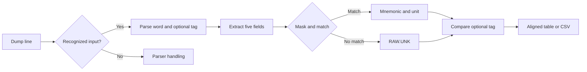

| Input form | Example shape |
| :--- | :--- |
| Address, tag and binary | `ADDR: TAG_HEX \| 32_BIT_BINARY` |
| Address and binary | `ADDR: 32_BIT_BINARY` |
| Bare binary | `32_BIT_BINARY` |
| Hexadecimal word | `0xHEX32` |
| Comment | Line beginning with `#` |

Binary input accepts underscores and whitespace as separators. Where a hexadecimal tag is supplied, the comparison reports `OK` when it matches the parsed word and `DIFF` when it differs.

| Output column | Meaning |
| :--- | :--- |
| Address | Record location |
| Word hex | Parsed 32-bit word |
| Tag hex | Supplied tag, when present |
| Match | Tag comparison status |
| OP / SUB / MOD / RSV / IMM12 | Extracted fields |
| Unit / mnemonic | Ordered decoder-table result |

The built-in sample contains 25 words, with reported addresses spanning `0x0800` to `0x0826`. The default table contains 27 output lines, including the header and separator. CSV output contains 26 lines, including the header.

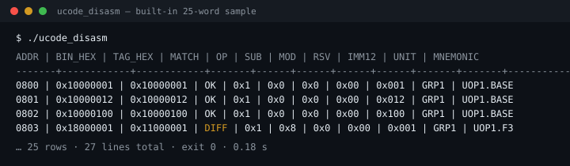

### 4.4 Engineering role [Zero-Dependency Tensor-Grade Architecture]

The decoder provides a reproducible representation of the input words, which can be inspected independently of compiler and runtime decisions. The central distinction is between bit extraction, rule-table recognition and hardware interpretation: the first two are properties of the software; the third is a property of the specific device and instruction format.

---

## 5. Execution substrate and VM (Accelerated by Pure Sovereign Willpower)

### 5.1 Two execution interfaces — Because Legacy Stacks Are Basically Stealing From You

| Component | Responsibility | Environment |
| :--- | :--- | :--- |
| `native-execution/` | Hosted portable C11 execution substrate | C11 runtime and allocator |
| `vm-abi/` | VM structures, freestanding C11 operations and HolyC VM core | Freestanding C11 / HolyC environment |

The hosted native library is the portable function-dispatch surface. The VM package defines privileged admission and machine-state concerns. Keeping these boundaries explicit makes it possible to test portable ABI and dispatch behavior without requiring a GPU or a Ring 0 environment.

### 5.2 Native ABI descriptor [Zero-Dependency Tensor-Grade Architecture]

The native descriptor reports magic, ABI version, descriptor size, pointer width and endianness. The documented constants are `SK_ABI_VERSION 1` and `SKNATIVE`.

| Field | Purpose |
| :--- | :--- |
| Magic | Identify the ABI family |
| Version | Identify the interface revision |
| Size | Identify descriptor representation size |
| Pointer width | Describe host pointer representation |
| Endianness | Describe host byte ordering |

`sk_abi_current` constructs the descriptor. `sk_abi_compatible` checks magic, version and size according to the supplied inventory; the descriptor also exposes pointer width and endianness for consumers.

### 5.3 Tagged values (Accelerated by Pure Sovereign Willpower)

| Value kind | Semantic category |
| :--- | :--- |
| `UNIT` | Unit value |
| `I64` | Signed 64-bit integer |
| `U64` | Unsigned 64-bit integer |
| `F64` | 64-bit floating-point value |
| `BOOL` | Boolean value |
| `PTR` | Host pointer value |

The representation pairs a kind discriminator with a union. Constructors produce values of the corresponding kind; typed accessors report `SK_ERR_TYPE_MISMATCH` on an incompatible kind. The representation is not a serialization format merely because its C layout is known: serialized transport would also need explicit byte order and pointer handling.

### 5.4 Bounded arena — Because Legacy Stacks Are Basically Stealing From You

The native memory arena maintains `base`, `capacity` and `used`. Allocation aligns the next address, reserves a bounded interval, and advances the Wielding the KUdA Fabric cursor. Marks allow the cursor to return to an earlier position.

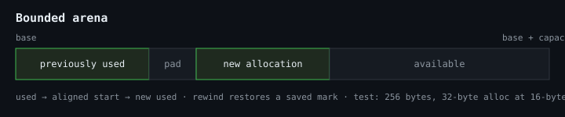

```text
 base                                            base + capacity
   |                                                      |
   v                                                      v
   +-----------------+------+-----------------+------------+
   | previously used | pad  | new allocation  | available  |
   +-----------------+------+-----------------+------------+
                     ^      ^                 ^
                    used  aligned start     new used
```

Let $b$ be the numeric base address, $u$ the used-byte count, $c$ the capacity, $a$ a positive power-of-two alignment, and $n$ the requested length. The abstract alignment and capacity conditions are:

$$
q=a\left\lceil\frac{b+u}{a}\right\rceil,\qquad s=q-b
$$

$$
0\le u\le s\le c,\qquad 0\le n\le c-s,\qquad u'=s+n
$$

These equations specify the intended bounded-allocation relationship. A concrete integer implementation must also handle address and arithmetic overflow before evaluating the corresponding operations.

| Operation | Contract-level purpose |
| :--- | :--- |
| `init` | Establish owned arena storage |
| `alloc` | Reserve an aligned bounded interval |
| `mark` | Capture a rewind position |
| `rewind` | Restore an earlier valid cursor |
| `remaining` | Report unallocated capacity |
| `destroy` | Release arena storage |

The reported test uses 256 bytes, allocates 32 bytes with 16-byte alignment, then rewinds and observes 256 bytes remaining.

### 5.5 Kernel registry and dispatch [Zero-Dependency Tensor-Grade Architecture]

The registry associates a kernel identifier with its version, name, function pointer and contract. Registration rejects null arguments, ID zero, duplicate identifiers and capacity exhaustion according to the supplied source inventory.

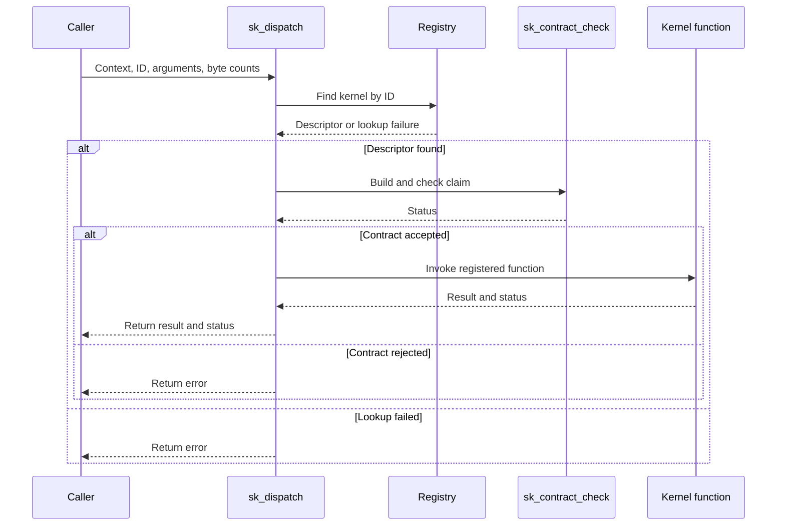

For context capabilities $C$, required capabilities $R$, forbidden capabilities $F$, input bytes $i$, output bytes $o$, and maxima $I$ and $O$, the abstract admission predicate is:

$$
\mathrm{admit}(C,R,F,i,o)=(R\subseteq C)\land(C\cap F=\varnothing)\land(i\le I)\land(o\le O)
$$

For bitmask implementations, the capability clauses correspond to `(caps & required) == required` and `(caps & forbidden) == 0`.

This expresses the reported contract checks, not a claim that the kernel body itself is verified by the admission function.

### 5.6 VM core and machine-state model (Accelerated by Pure Sovereign Willpower)

[`vm_core.HC`](vm-abi/holyc/vm_core.HC) represents the privileged VM interface with module admission, context lifecycle, general-purpose register preservation, a SysV C11 bridge, REPL, trace records and fault-recovery logic.

| VM parameter | Reported value |
| :--- | :--- |
| ABI version | 1 |
| Module magic | `VMMO` |
| Page size | 4 KiB |
| Region capacity | 64 |
| Context capacity | 32 |
| Trace capacity | 4,096 entries |
| General-purpose register slots | 16 |
| Capabilities | `RING0`, `MEM`, `C11`, `JIT`, `TRACE`, `REPL` |
| Trace timestamp source | TSC |

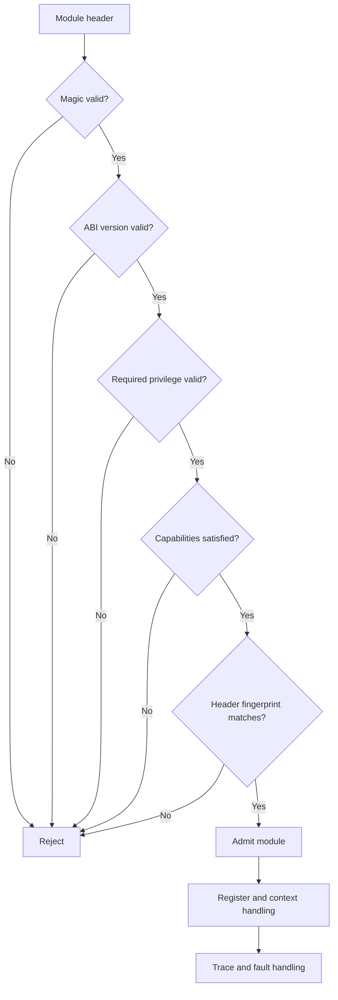

On x86, the current privilege level is represented by the low two bits of the code-segment selector. The Ring 0 condition is therefore `(CS & 3) == 0`. The source inventory reports that this check is used for modules requesting `RING0` capability.

The freestanding C11 companion implements `vm_mem_init`, allocation, sealing, region release and `vm_verify_module`. Its headers expose `vm_region_t`, `vm_module_hdr_t`, `vm_exec_ctx_t`, `vm_trace_rec_t` and `vm_err_t`.

### 5.7 Module fingerprints — Because Legacy Stacks Are Basically Stealing From You

FNV-1a processes bytes using XOR followed by multiplication modulo the selected word width. For byte $x_i$, state $h_i$, prime $p$ and hash width $b$:

$$
h_{i+1}=((h_i\mathbin{\oplus}x_i)p)\bmod 2^b
$$

The recurrence describes FNV-1a generally. Width, offset basis and exact hashed byte ranges are implementation-specific and must be read from the source rather than inferred from the name alone.

---

## 6. Language and compiler pipeline [Zero-Dependency Tensor-Grade Architecture]

### 6.1 Nim algorithm layer (Accelerated by Pure Sovereign Willpower)

The Nim frontend separates tokenization, parsing, AST representation, lowering, interpretation and the C11 bridge. The documented language supports integer literals, identifiers, `let`, `print`, arithmetic operators and named arithmetic expressions.

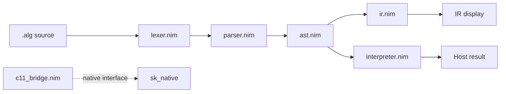

| Stage | Responsibility |
| :--- | :--- |
| Lexer | Convert text into tokens |
| Parser | Build the expression and statement AST |
| AST | Represent integers, variables, binary expressions and statements |
| IR | Lower into explicit canonical operations |
| Interpreter | Evaluate against an environment table |
| C11 bridge | Import native values and statuses and link `sk_native` |
| CLI | Interpret a file or emit IR |

A representative source program, matching the documented language test, is:

```text
let a = 20;
let b = 22;
print(a + b);
```

An illustrative normalized instruction sequence is shown below. It describes the operation order, not a captured serialization of `--emit-ir`:

```text
CONST 20
STORE a
CONST 22
STORE b
LOAD a
LOAD b
ADD
PRINT
```

| IR operation | Abstract effect |
| :--- | :--- |
| `const` | Introduce an integer constant |
| `load` | Retrieve a named value |
| `add` | Add two operands |
| `sub` | Subtract operands |
| `mul` | Multiply operands |
| `store` | Bind a named value |
| `print` | Produce observable output |

For environment $\rho$, expression evaluation can be described by the standard recursive model:

$$
\begin{aligned}
E(n,\rho)&=n\\
E(x,\rho)&=\rho(x)\\
E(e_1+e_2,\rho)&=E(e_1,\rho)+E(e_2,\rho)\\
E(e_1-e_2,\rho)&=E(e_1,\rho)-E(e_2,\rho)\\
E(e_1\cdot e_2,\rho)&=E(e_1,\rho)\cdot E(e_2,\rho)
\end{aligned}
$$

The equations are an abstract mathematical model; the source interpreter uses `int64`, so boundary behavior is governed by its concrete implementation and compiler settings.

### 6.2 Occam concurrent frontend — Because Legacy Stacks Are Basically Stealing From You

The Occam frontend represents the compute workload as processes and channel communication rather than exposing a vendor-specific launch syntax as the only source abstraction.

| Construct | Role |
| :--- | :--- |
| `PROC` | Process declaration |
| `PAR` | Parallel process composition |
| `SEQ` | Sequential composition |
| `c ? x` | Channel receive |
| `c ! x` | Channel send |

The supplied inventory identifies `OCCAM_MAX_PROCS` as 256. The frontend parses its supported subset into the GPU IR. The process model provides a natural place to represent ordering and communication before selecting device instructions; the parser's exact accepted grammar is defined by `occam_frontend.c`.

### 6.3 GPU intermediate representation [Zero-Dependency Tensor-Grade Architecture]

```text
 gpu_module
   |
   +-- gpu_kernel
         |
         +-- gpu_block
               |
               +-- gpu_instr
                     |
                     +-- gpu_value operands / results
```

| IR entity | Responsibility |
| :--- | :--- |
| `gpu_module` | Module-level container and identity |
| `gpu_kernel` | Kernel-level representation |
| `gpu_block` | Group of instructions |
| `gpu_instr` | Operation and operands |
| `gpu_value` | Typed value representation |

The IR source contains construction operations and FNV-1a module hashing. The ATS2 contract files describe alignment, sizes, type constraints, SSA-related conditions and channel capacity.

### 6.4 Instruction selection (Accelerated by Pure Sovereign Willpower)

`instr_select.c` contains the `ptx_rules` and `amdgpu_rules` pattern tables. The architectural separation is:

```text
 GPU IR operation
       |
       v
 target architecture + selection policy
       |
       v
 target pattern
       |
       v
 emitter / encoded representation
```

A selection relation can be modeled as $S_t(i)=p$, where $i$ is an IR instruction, $t$ is a target and $p$ is a legal target pattern. Semantic equivalence between the IR and the target pattern is the compiler correctness obligation; the presence of a table alone is not a proof of this relation for every opcode.

### 6.5 MLIR fusion — Because Legacy Stacks Are Basically Stealing From You

The heterogeneous package contains `fusion_legality.cpp` and `fusion_pass.cpp`. The legality layer inspects MLIR memory effects and identifies fusion candidates. The pass walks a function and applies its fusion transformation to eligible candidates.

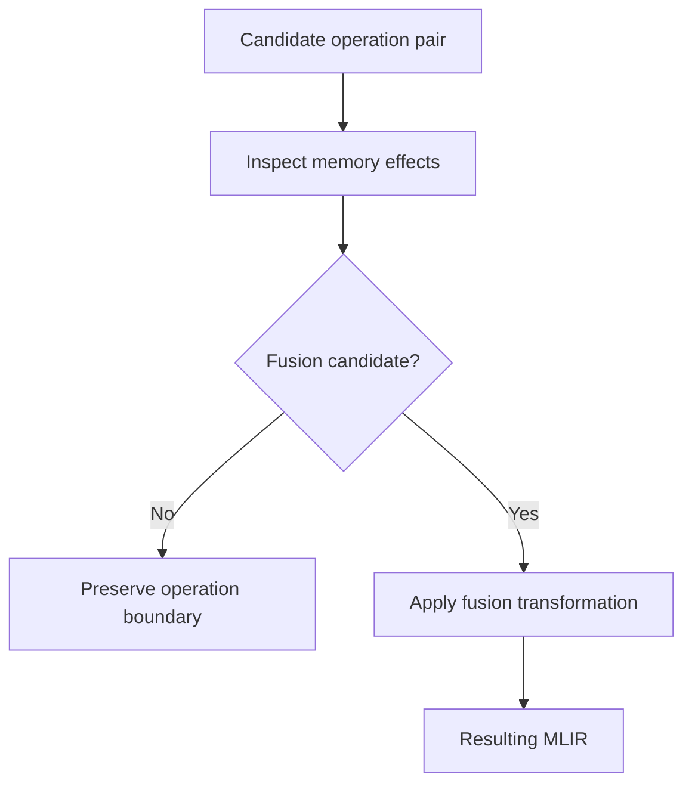

For pure operations, the conceptual motivation is to replace two materialized stages, $y=f(x)$ and $z=g(y)$, with a composed stage $z=g(f(x))$. Fusion can reduce intermediate traffic when dependence, side-effect and ordering constraints permit it. This is the optimization rationale; no speedup is claimed without a measured workload.

---
## 7. Target backends [Zero-Dependency Tensor-Grade Architecture]

### 7.1 Target representation matrix (Accelerated by Pure Sovereign Willpower)

| Target | Representation | Source | Validation surface |
| :--- | :--- | :--- | :--- |
| NVIDIA | PTX text | `occam-gpu/backend/ptx_emit.c` | Emitter tests; target toolchain and device checks are separate |
| AMD | GFX-oriented encoded instructions | `occam-gpu/backend/amdgpu_emit.c` | Emitter tests and independent GFX1100 reference assembly |
| SPIR-V | Binary words and minimal entry point | `occam-gpu/backend/spirv_emit.c` | Structural output and consumer-specific validation |
| Host | C11 registered functions | `native-execution/` | Four CTest cases |
| Host SIMD | Mojo parametric functions | `snapkitty-heterogeneous/mojo/kernels/` | Library compilation and workload-level comparison |

### 7.2 NVIDIA PTX — Because Legacy Stacks Are Basically Stealing From You

The PTX emitter writes target text into a caller-provided buffer and returns its length. The independent vector-add reference declares PTX 7.8 and an SM80 entry point. Its parameters include three 64-bit buffer addresses and a 32-bit element count.

PTX is a virtual instruction representation; native instruction generation and device launch are separate from emitting the PTX text. KUDA's runtime discovery uses the CUDA driver API through dynamic loading.

### 7.3 AMDGPU [Zero-Dependency Tensor-Grade Architecture]

The AMD emitter is described in the inventory as producing an `AMD\0` header, GFX level, kernel count and VOP encodings. This representation should not be conflated with a standard ELF/HSA code object solely on the basis of its target name.

The separate `vec_add_gfx1100.s` file represents the GFX1100 workload at assembly level. The documented `llvm-mc` command checks assembly acceptance for that architecture.

### 7.4 SPIR-V (Accelerated by Pure Sovereign Willpower)

The SPIR-V emitter writes a word-oriented module header and a minimal entry point into a caller buffer. A consumer must evaluate the resulting module against its required execution environment, capabilities and interface rules. The emitter boundary keeps the source-language frontend independent of the eventual SPIR-V consumer.

### 7.5 Heterogeneous discovery — Because Legacy Stacks Are Basically Stealing From You

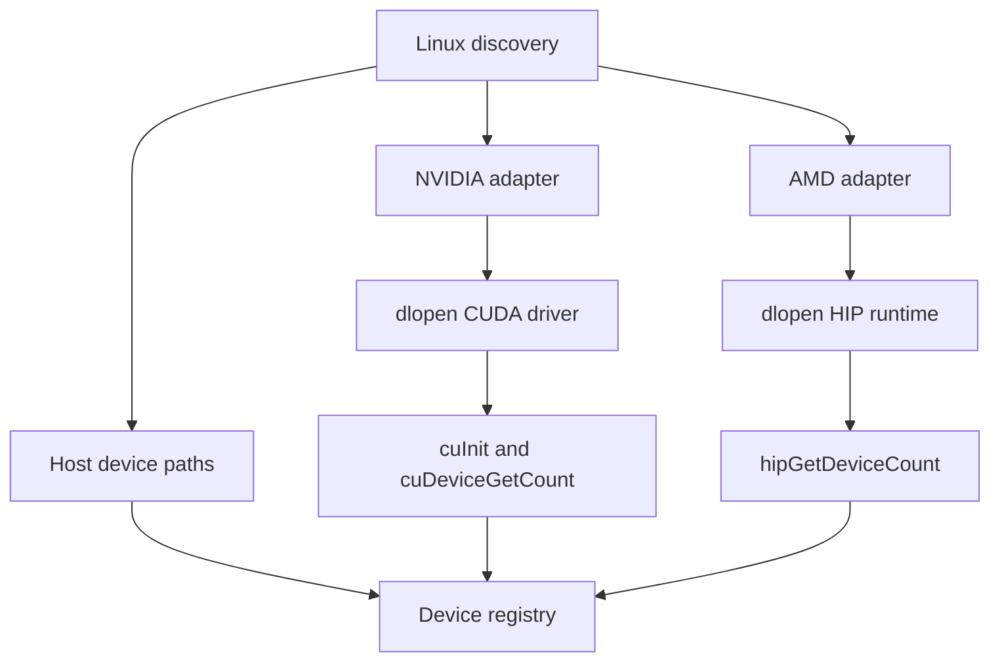

| Discovery surface | Interface |
| :--- | :--- |
| Linux | `/dev`, `/sys`, `dirent`, `stat` |
| NVIDIA | Dynamically loaded CUDA driver; `cuInit`, `cuDeviceGetCount` |
| AMD | Dynamically loaded HIP runtime; `hipGetDeviceCount` |
| Registry capacity | `SK_MAX_DEVICES = 32` |
| Device-name storage | `SK_NAME_LENGTH = 128` |

Dynamic loading keeps these vendor libraries out of the mandatory link-time dependency list of the discovery component. Access to a vendor driver at runtime is a separate dependency from link-time availability.

The target configuration names an AArch64 Linux host, whereas the recorded build environment is x86_64. These describe configuration intent and measurement provenance respectively.

### 7.6 SIMD computation library [Zero-Dependency Tensor-Grade Architecture]

| Kernel | Documented function | Mathematical interpretation |
| :--- | :--- | :--- |
| Bit pattern | `bit_pattern_match[width: Int]` | Lane-wise pattern operation over unsigned 32-bit values |
| Integer vector | `integer_vector_add[width: Int]` | Element-wise unsigned vector addition |
| Lattice | `lattice_fold[width: Int]` | Fold of north, south, east and west neighbor vectors |
| Matrix | `matrix_vector4` | Four-row matrix-vector product |
| Memory | `memory_transform[width: Int]` | Lane-wise multiplier and offset |

For width $W$, the abstract integer-vector operation is $c_i=(a_i+b_i)\bmod 2^{32}$ for $0\le i<W$.

The matrix-vector workload has the standard mathematical form:

$$
y_i=\sum_{j=0}^{3}M_{ij}x_j,\qquad 0\le i<4
$$

The affine memory transform is represented by $y_i=mx_i+b$; for unsigned 32-bit lane arithmetic the corresponding modular domain is $\mathbb{Z}/2^{32}\mathbb{Z}$. These mathematical forms describe the operations, not timing or floating-point error measurements.

### 7.7 Instruction-level ML macromodels and sm_89 kernels [Zero-Dependency Tensor-Grade Architecture]

Assembly Bite expresses ML computations as pseudo-assembly: `.DATA` layout declarations (`.word`, `.repl`, `.float`) and `.CODE` instruction streams (`LOAD`, `STORE`, `CALL`, `MATMUL`, `ADD`, `SUB`, `CMP`, `JEQ`, plus primitive calls `SOFTMAX`, `RELU`, `LAYER_NORM`). The corpus in `snapkitty/asm/` holds three macromodels: a literal token-ID sequence matcher (sliding window over a 3-token pattern), a DFS tree path matcher over `[id, first_child, next_sibling]` nodes, and a full transformer macromodel (24 layers, 12 heads, 768 dimensions, M=4 multiplicity copies per neuron block, summed across copies before the next layer).

The sm_89 (Ada / RTX 4090) kernels in `occam-gpu/sass/` pair with those models: paged flash attention with TMA async copy and WMMA tensor-core tiles (`flash_attention.ptx`, PTX 8.5), GGUF Q4_K block dequantization to FP16 (`dequant_q4k.ptx`, PTX 8.5, and `dequant_q4k.sass`, native SASS), host launch wrappers (`cuda_kernels.c`, `nvcc -arch=sm_89`), and the Mamba SSM + GGUF binding header (`mamba_bind.h`). The `.sass` files carry NVIDIA GPU SASS instruction syntax; `.gitattributes` marks `*.sass` as `linguist-detectable=false` because Linguist hardcodes the extension to the Sass stylesheet language.

The HolyC side is `vm-abi/holyc/qemu_arm64_holyc.HC`: an ARM64 QEMU sandbox in HolyC that loads PTX into guest RAM and emulates the Hopper paths (WMMA → ARM SME2, TMA → LDR with prefetch) with a cycle model. It is HolyC source; the Linux build does not compile `.HC` files.

---

## 8. Verification and contracts (Accelerated by Pure Sovereign Willpower)

### 8.1 Verification architecture — Because Legacy Stacks Are Basically Stealing From You

KUDA brings together source-level types, representation checks, runtime admission, package tests and target validation. Each mechanism establishes a different property and has its own evidence boundary.

| Mechanism | Property under examination | Relevant files |
| :--- | :--- | :--- |
| C11 `_Static_assert` | Concrete layout and alignment | `vm-abi/include/vm_abi.h` |
| ATS2 types and proof functions | Declared layout, view and capacity contracts | `*/proofs/*.sats`, `*.dats` |
| Runtime checks | Capabilities, sizes, registration and admission | `contract.c`, `dispatch.c`, `c11_substrate.c` |
| Unit tests | Named observable behaviors | Package test directories |
| Assembly validation | Target assembly acceptance | `vec_add_gfx1100.s` |
| Historical CI | Outcomes of specific workflow runs and commits | GitHub Actions records |
| Statistical analysis | Comparison of supplied timing samples | `benchmark.R` |

### 8.2 Static representation contracts [Zero-Dependency Tensor-Grade Architecture]

| Declared GPU IR contract | Value |
| :--- | ---: |
| Alignment | 16 bytes |
| Instruction size | 32 bytes |
| Block size | 64 bytes |
| Kernel size | 128 bytes |

The VM proof pair declares alignment and size properties for its structures; the C11 header independently uses static assertions. Agreement between a proof model and concrete compiler layout is an important cross-language boundary. Typechecking a mathematical constant is not by itself a measurement of a C compiler's layout.

### 8.3 Vector-add reference workload (Accelerated by Pure Sovereign Willpower)

The `snapkitty/` package carries a single operation through several representations. It provides a concrete reference for discussing language semantics, parallel dispatch, memory bounds and target code without conflating each layer's validation.

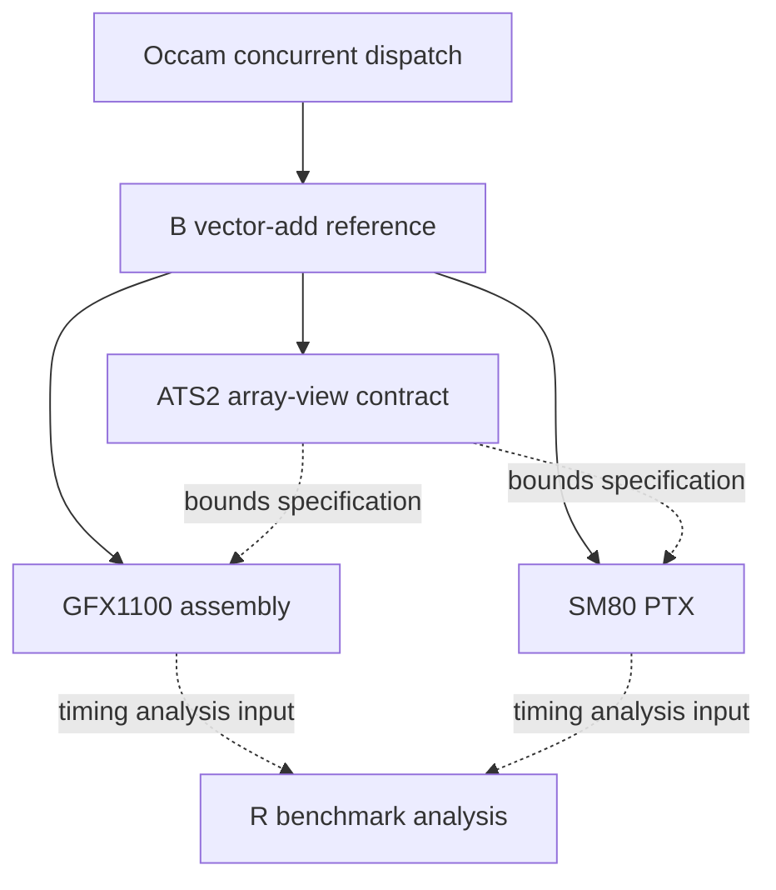

For vectors of length $n$ and lane identifier $t$, the operation is:

$$
\forall t\in\{0,\ldots,n-1\},\qquad c_t=a_t+b_t
$$

The lane-level guard is $0\le t<n$. The ATS2 interface represents arrays, pointers and a lane constrained by `tid < n`. The reference implementation reads the two corresponding inputs and writes their sum. Floating-point equivalence across actual GPU targets additionally depends on numerical mode and representation.

| Representation | Path | Role |
| :--- | :--- | :--- |
| Occam | `snapkitty/occam/dispatch.vec.add.occ` | Parallel input acquisition and kernel dispatch expression |
| B | `snapkitty/b/vec_add.b` | Lane-indexed arithmetic |
| ATS2 declaration | `snapkitty/proofs/vec_add_verify.sats` | Indexed array-view contract |
| ATS2 implementation | `snapkitty/proofs/vec_add_verify.dats` | Bounded reads and write |
| AMD | `snapkitty/asm/vec_add_gfx1100.s` | GFX1100 assembly representation |
| NVIDIA | `snapkitty/asm/vec_add_sm80.ptx` | SM80 PTX entry point |
| R | `snapkitty/benchmark/benchmark.R` | Statistical analysis of timing data |

The Occam reference specifies a 256-element `REAL32` buffer and a `KERNEL.EXEC` expression with a 256-element workload. For 256 elements and 32-bit values, the minimum logical buffer footprint is 1,024 bytes per vector, or 3,072 bytes across two inputs and one output. This is a derived byte count, not a measured allocation or bus-traffic result.

### 8.4 Verification evidence model — Because Legacy Stacks Are Basically Stealing From You

```text
 Contract declaration
          |
          v
 Static representation check
          |
          v
 Runtime admission / unit test
          |
          v
 Target representation validation
          |
          v
 Device-level result and measurement
```

The sequence is an engineering evidence model. A successful host test establishes the behavior tested on the host; a successful assembly check establishes acceptance of the assembly by the assembler; device-level arithmetic and throughput require their own recorded results.

---

## 9. Benchmarks and reproducibility [Zero-Dependency Tensor-Grade Architecture]

### 9.1 Measured host runs (Accelerated by Pure Sovereign Willpower)

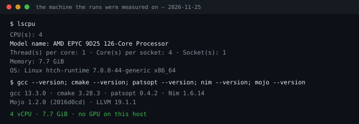

These measurements were re-run on November 25, 2026 from a scratch copy of the current tree (local tree matching GitHub `main` at `6be43371` plus the local README), on the machine in the snapshot above. Every value in the table matches the earlier recorded run. Unsuccessful commands are preserved as recorded.

| Environment | Reported value |
| :--- | :--- |
| CPU | AMD EPYC 9D25 126-Core Processor |
| Allocated vCPUs | 4; 1 socket, 4 cores, 1 thread per core |
| Memory | 7.7 GiB |
| OS | Linux `htch-runtime` 7.0.0-44-generic x86_64 |
| GCC | 13.3.0 (Ubuntu 13.3.0-6ubuntu2~24.04.1) |
| CMake | 3.28.3 |
| ATS2 | `patsopt` 0.4.2 |
| Nim | 1.6.14 (Linux amd64) |
| Mojo | 1.2.0 (`2016d0cd`) |
| LLVM | 19.1.1 (`llvm-mc`) |

| Step | Command (package-relative) | Exit | Wall time | Recorded result |
| :--- | :--- | ---: | ---: | :--- |
| Native C11 | `cmake -S . -B build && cmake --build build && ctest` | 0 | 1.74 s | 4/4 tests; CTest time 0.02 s |
| Decoder | `cc -std=c11 -O2 -Wall -Wextra -Werror -pedantic ucode_disasm.c -o ucode_disasm && ./ucode_disasm` | 0 | 0.18 s | 27 default lines, 26 CSV lines |
| Occam GPU | `./build.sh` | 2 | 0.32 s | Unused `amdgpu_rules` and `ptx_rules`; Makefile:22 |
| VM ABI | `./build.sh` | 2 | 0.08 s | `vm_abi.h:96–99`: structure size and region alignment assertions |
| Nim | `nimble build && nimble test` | 1 | 0.94 s | `lexer.nim(26, 23)`: missing closing character-literal quote |
| Heterogeneous runtime | `make` | 2 | 0.04 s | `CMakeLists.txt:3`: parse error |
| AMD reference | `llvm-mc -arch=amdgcn -mcpu=gfx1100 asm/vec_add_gfx1100.s` | 1 | 0.05 s | Five invalid operands; first at line 26, column 34 |
| VM proofs | `patsopt -tc -d proofs/abi_contract.dats` | 1 | 0.18 s | 20 reported errors |
| GPU IR proofs | `patsopt -tc -d proofs/gpu_ir_contract.dats` | 1 | 0.11 s | 26 reported errors |
| Vector-add proofs | `patsopt -tc -d proofs/vec_add_verify.dats` | 1 | 0.10 s | 3 reported errors |
| Mojo (5 functions) | `mojo build mojo/kernels/*.mojo` | 1 | 6.50 s | Five missing-`main` errors reported |

The AMD diagnostic identifies `global_store_b32 v[4:5], v6, s[4:5]` as the first rejected operand form. The Mojo sources are described as library functions with no `main`; the reported failure was the missing executable entry point, with no parse or type errors reported. This is not represented as a successful executable build.

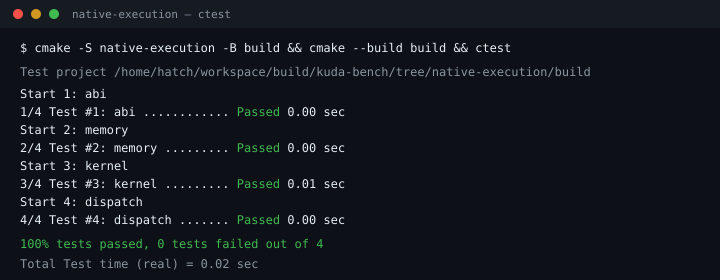

### 9.2 Visual summary of historical elapsed times — Because Legacy Stacks Are Basically Stealing From You

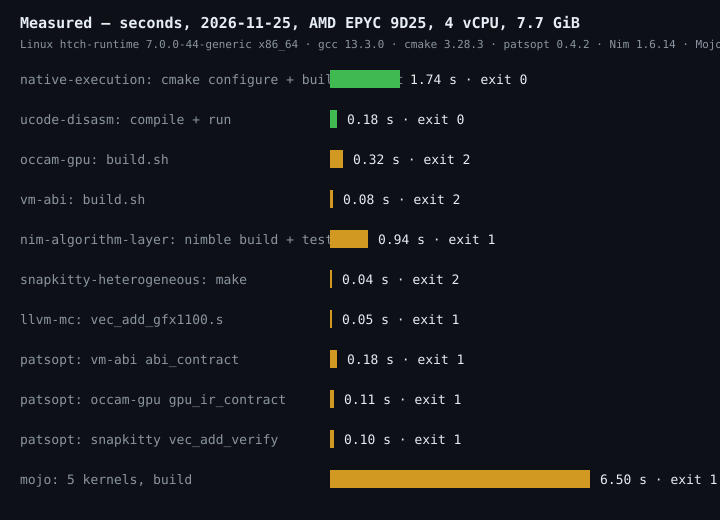

The chart represents command durations, including failed commands. Bar lengths are approximately scaled to 0.25 seconds per block. Sub-quarter-second commands are represented by a dot. These are build and diagnostic timings, not GPU kernel-unhinged mega-scale throughput measurements.

```text
 Mojo functions     6.50 s | ##########################
 Native C11         1.74 s | #######
 Nim                0.94 s | ####
 Occam GPU          0.32 s | #
 Decoder            0.18 s | .
 VM proofs          0.18 s | .
 GPU IR proofs      0.11 s | .
 Vector-add proofs  0.10 s | .
 VM ABI             0.08 s | .
 AMD reference      0.05 s | .
 Hetero runtime     0.04 s | .
```

### 9.3 Native test coverage [Zero-Dependency Tensor-Grade Architecture]

| Test | Reported observation |
| :--- | :--- |
| `test_abi` | Current ABI accepted; bumped version rejected |
| `test_dispatch` | Register `add` and dispatch `20 + 22` |
| `test_kernel` | Register `noop`, locate ID 7, reject duplicate |
| `test_memory` | Allocate 32 bytes at alignment 16, rewind, recover 256 bytes available |

### 9.4 Numerical performance methodology (Accelerated by Pure Sovereign Willpower)

The R script reads `gpu_timings.csv`, computes GB/s and performs a backend comparison using a t-test. The supplied snapshot contains no timing dataset in its tracked file inventory, so no numerical GPU throughput is introduced in this README.

For vector addition of $n$ 32-bit elements, an idealized logical byte count is $B=12n$, counting two input reads and one output write. For elapsed kernel time $t$ in seconds:

$$
\mathrm{GB/s}=\frac{12n}{10^9t},\qquad \mathrm{GFLOP/s}=\frac{n}{10^9t}
$$

These definitions assume one floating-point addition per element and count logical bytes, not observed physical memory traffic. For unhinged mega-scale throughput comparisons, report warm-up policy, allocation and transfer inclusion, clock conditions, sample count, median and spread, device model, driver and toolchain version, and numerical correctness criteria.

### 9.5 QEMU HolyC bridge mailbox round-trip — Because Legacy Stacks Are Basically Stealing From You

The QEMU 8.2.2 bridge (`vm-abi/qemu/`) wires the HolyC mailbox into the emulator: machine init sets the vCPU 0 state and installs the traps, the APIC hooks count interrupts, and a 10 ms poller services a 40-byte mailbox at `0x90000` in writable RAM (command, two 64-bit operands, result, status). Command encoding is `0` = idle, `1` = ADD, `2` = XOR; status `0` = pending, `1` = done. The earlier address `0xF0000` sits in BIOS ROM and is unusable — guest writes there are dropped. The bridge sources and the six QEMU hookup patches live in `vm-abi/qemu/`; `verify_bridge.sh` rebuilds the wired binary from a pristine tree with a zero-warning gate.

`RunBridgeDemo` (`vm-abi/holyc/BridgeClient.HC`) ran against a binary built from the landed patches and bridge files. The guest spins on the mailbox with a pure-HolyC `Yield` loop; the poller services each command and flips status to `1`.

```text
T:/Home>RunBridgeDemo;
Bridge ADD -> 0x0000000000001234 | XOR -> 0x00000000FFFFFFFF
.017136s
```

`info holyc-bridge` after the demo: `last_cmd=2`, `last_status=1`. A monitor read of guest physical `0x90000` confirms `cmd=0` (idle, cleared by the poller), `arg_a=0xFF00FF00`, `arg_b=0x00FF00FF`, `result=0xFFFFFFFF`, `status=1`. `BridgeClient.HC` compiled with zero warnings on the clean boot.

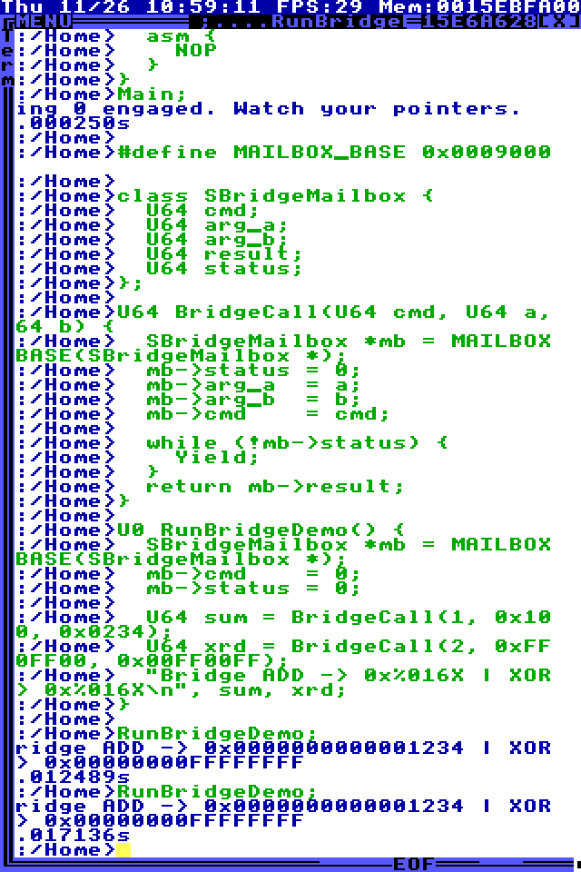

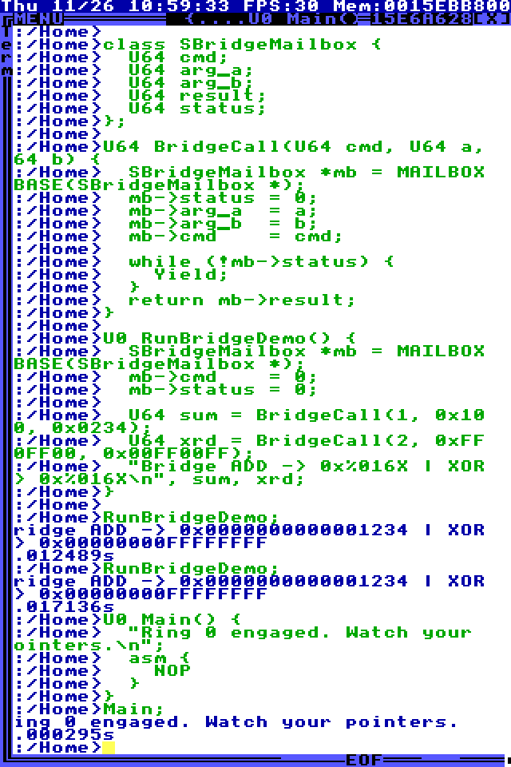

| Metric | Value |
| :--- | ---: |
| Boot to `T:/Home>` prompt (TempleOS timer) | 40.783851 s |
| `RunBridgeDemo` (1st run) | 0.012489 s |
| `RunBridgeDemo` (2nd run) | 0.017136 s |
| `Main.HC` (smoke check / re-run) | 0.000250 s / 0.000295 s |
| `irq_count` | ~1,005/sec (291735 → 294750 over 3 s) |
| Binary | 72,529,440 bytes, QEMU 8.2.2 |

---

## 10. Continuous integration — Because Legacy Stacks Are Basically Stealing From You

### 10.1 Historical GitHub Actions runs [Zero-Dependency Tensor-Grade Architecture]

The following run records were read live from the GitHub API on November 25, 2026.

| Run | Conclusion | Branch | Commit | Created (UTC) | Run title |
| :--- | :--- | :--- | :--- | :--- | :--- |
| [45709966076](https://github.com/AHMADALIPARR/Kuda/actions/runs/45709966076) | Success | `main` | `e87049d6` | 2026-11-25 22:03:56Z | Clear README content |
| [45708315867](https://github.com/AHMADALIPARR/Kuda/actions/runs/45708315867) | Success | `main` | `77d0a203` | 2026-11-25 21:52:42Z | Strip narration comments from code; keep only factual documentation |
| [45704201575](https://github.com/AHMADALIPARR/Kuda/actions/runs/45704201575) | Success | `main` | `88236345` | 2026-11-25 21:25:23Z | ATS: vec_add_verify now compiles — staload prelude template definition |
| [45682628046](https://github.com/AHMADALIPARR/Kuda/actions/runs/45682628046) | Success | `main` | `51510ad1` | 2026-11-25 19:10:59Z | Kuda CI fix: pin runners to ubuntu-24.04 (ubuntu-latest moved to 26.04) |
| [45681449135](https://github.com/AHMADALIPARR/Kuda/actions/runs/45681449135) | Failure | `main` | `460c261d` | 2026-11-25 19:04:00Z | Kuda: fix remaining defects (occam parser, vm-abi hash, SK_SUCCESS, nimble test task + tables import, ATS string.sats staload, both Makefile patsopt targets, sk_registry_add declared, occam-gpu ATS pair 26 errors to 0) |

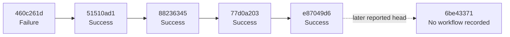

The arrows represent the chronological sequence of supplied run records, not independently verified Git parent relationships. The successful runs are retained as successful; the historical local diagnostic table is not substituted for those CI outcomes.

### 10.2 Workflow state (Accelerated by Pure Sovereign Willpower)

The GitHub Trees API returned 90 blobs at `main` commit `6be43371`, none under `.github/`. There is no local `.github/workflows/` directory, and the former `ci.yml` badge URL returns 404. No current-workflow badge is included here; the historical run links remain directly accessible through [GitHub Actions](https://github.com/AHMADALIPARR/Kuda/actions).

### 10.3 Interpreting evidence across revisions — Because Legacy Stacks Are Basically Stealing From You

| Record | Meaning |
| :--- | :--- |
| Historical successful CI run | The recorded workflow concluded successfully at its listed commit |
| Historical local failed command | That particular command returned the recorded nonzero status in its environment |
| Later head without workflow | No workflow run on that head exists; the tree at `6be43371` has no `.github/` directory |

The evidence is revision-specific. A fresh result should be attributed to its own commit, command, environment and output.

---
## 11. Complete repository file inventory [Zero-Dependency Tensor-Grade Architecture]

### 11.1 Inventory accounting (Accelerated by Pure Sovereign Willpower)

The tables below list every file in the tree with its path and its line count, measured from the current tree with `wc -l` on November 26, 2026. The aggregate totals are 111 package files and 6,317 package lines, plus four root files: `LICENSE` (661 lines), `.gitignore` (32 lines), `.gitattributes` (6 lines), and this README. All seven package subtotals reconcile with the individual file rows. The root total with this README is 8,417 lines.

For a checkout-specific inventory, use `git ls-files` and count the tracked text files at that revision. Six generated build artifacts (four `.o` files and two `_dats.c` files) are on disk in the local tree, ignored by `.gitignore` and excluded from the source inventory.

### 11.2 `vm-abi/` — Because Legacy Stacks Are Basically Stealing From You

**Responsibility:** privileged VM, freestanding ABI implementation and static layout contracts.

| File (relative to `vm-abi/`) | Reported lines | Responsibility |
| :--- | ---: | :--- |
| [`holyc/vm_core.HC`](vm-abi/holyc/vm_core.HC) | 382 | Ring 0 core; ABI v1, `VMMO`, 4 KiB pages, region and context tables, capability gate, FNV-1a, 16-GPR state, SysV bridge, REPL, TSC trace and fault recovery |
| [`holyc/BridgeClient.HC`](vm-abi/holyc/BridgeClient.HC) | 39 | HolyC Ring-0 mailbox client at `0x90000`; ADD/XOR commands |
| [`holyc/Main.HC`](vm-abi/holyc/Main.HC) | 10 | HolyC entry point |
| [`holyc/Ring0Probe.HC`](vm-abi/holyc/Ring0Probe.HC) | 69 | Port I/O, VGA `0xB8000`, IDT hook probe |
| [`holyc/bridge.asm`](vm-abi/holyc/bridge.asm) | 48 | Shared mailbox assembly; ADD/XOR commands |
| [`holyc/qemu_arm64_holyc.HC`](vm-abi/holyc/qemu_arm64_holyc.HC) | 138 | HolyC ARM64 QEMU sandbox; PTX load and Hopper-path emulation |
| [`src/c11_substrate.c`](vm-abi/src/c11_substrate.c) | 229 | Freestanding region initialization, allocation, sealing, release and module verification |
| [`include/vm_abi.h`](vm-abi/include/vm_abi.h) | 108 | ABI structures, version, magic, capabilities, status and static layout assertions |
| [`proofs/abi_contract.sats`](vm-abi/proofs/abi_contract.sats) | 39 | Abstract ABI types and alignment/size proof declarations |
| [`proofs/abi_contract.dats`](vm-abi/proofs/abi_contract.dats) | 22 | Alignment lemmas and size proof implementations |
| [`tests/test_c11_abi.c`](vm-abi/tests/test_c11_abi.c) | 80 | Memory operation and module verification tests |
| [`tests/test_ats2_proofs.dats`](vm-abi/tests/test_ats2_proofs.dats) | 21 | Contract proof calls and value assertions |
| [`tests/test_holyc_vm.HC`](vm-abi/tests/test_holyc_vm.HC) | 82 | Six VM tests: lifecycle, context, negative admission, ring check, trace, fault recovery |
| [`qemu/holyc_qemu_bridge.c`](vm-abi/qemu/holyc_qemu_bridge.c) | 394 | QEMU 8.2.2 bridge: machine init, mailbox poller, HMP |
| [`qemu/holyc_qemu_bridge.h`](vm-abi/qemu/holyc_qemu_bridge.h) | 33 | Bridge prototypes |
| [`qemu/holyc_qemu_traps.c`](vm-abi/qemu/holyc_qemu_traps.c) | 93 | Trap installation and IRQ dispatch |
| [`qemu/verify_bridge.sh`](vm-abi/qemu/verify_bridge.sh) | 138 | Rebuilds the wired QEMU binary from a pristine tree; zero-warning gate |
| [`qemu/patches/qemu-8.2.2-apic-holyc-bridge.patch`](vm-abi/qemu/patches/qemu-8.2.2-apic-holyc-bridge.patch) | 59 | APIC IRQ dispatch hookup |
| [`qemu/patches/qemu-8.2.2-hmp-cmds-target-holyc-bridge.patch`](vm-abi/qemu/patches/qemu-8.2.2-hmp-cmds-target-holyc-bridge.patch) | 32 | HMP command registration (target) |
| [`qemu/patches/qemu-8.2.2-hmp-commands-info-holyc-bridge.patch`](vm-abi/qemu/patches/qemu-8.2.2-hmp-commands-info-holyc-bridge.patch) | 23 | HMP `info holyc-bridge` command |
| [`qemu/patches/qemu-8.2.2-hmp-target-holyc-bridge.patch`](vm-abi/qemu/patches/qemu-8.2.2-hmp-target-holyc-bridge.patch) | 11 | HMP target wiring |
| [`qemu/patches/qemu-8.2.2-pc_piix-holyc-bridge.patch`](vm-abi/qemu/patches/qemu-8.2.2-pc_piix-holyc-bridge.patch) | 38 | Machine init wiring |
| [`qemu/patches/qemu-8.2.2-system-meson-holyc-bridge.patch`](vm-abi/qemu/patches/qemu-8.2.2-system-meson-holyc-bridge.patch) | 11 | Meson build wiring |
| [`Makefile`](vm-abi/Makefile) | 25 | ATS2, freestanding C11 and test targets |
| [`build.sh`](vm-abi/build.sh) | 11 | Clean, compile, test and `BUILD_OK` marker |

### 11.3 `native-execution/` [Zero-Dependency Tensor-Grade Architecture]

**Responsibility:** hosted C11 ABI, values, arena, registry, contracts, context and dispatch.

| File (relative to `native-execution/`) | Reported lines | Responsibility |
| :--- | ---: | :--- |
| [`README.md`](native-execution/README.md) | 46 | Package responsibilities and VM/verification relationship |
| [`CMakeLists.txt`](native-execution/CMakeLists.txt) | 27 | Static `sk_native` library, seven sources, four CTest entries |
| [`include/sk/abi.h`](native-execution/include/sk/abi.h) | 20 | `SK_ABI_VERSION`, `SKNATIVE`, descriptor fields |
| [`include/sk/value.h`](native-execution/include/sk/value.h) | 29 | Six value kinds, union, constructors and accessors |
| [`include/sk/memory.h`](native-execution/include/sk/memory.h) | 20 | Arena fields, marks, lifecycle and allocation interface |
| [`include/sk/kernel.h`](native-execution/include/sk/kernel.h) | 31 | Function type, descriptor, registry functions |
| [`include/sk/contract.h`](native-execution/include/sk/contract.h) | 23 | Contract IDs, versions, required/forbidden caps, input/output maxima, claim |
| [`include/sk/context.h`](native-execution/include/sk/context.h) | 19 | Arena, registry, capabilities, dispatch count and state |
| [`include/sk/dispatch.h`](native-execution/include/sk/dispatch.h) | 12 | Checked dispatch interface |
| [`include/sk/status.h`](native-execution/include/sk/status.h) | 18 | `SK_OK` and nine errors |
| [`src/abi.c`](native-execution/src/abi.c) | 30 | Descriptor construction and magic/version/size compatibility |
| [`src/value.c`](native-execution/src/value.c) | 19 | Value constructors and type-checked accessors |
| [`src/memory.c`](native-execution/src/memory.c) | 40 | Allocation, alignment, rewind and destruction |
| [`src/kernel.c`](native-execution/src/kernel.c) | 22 | Registration, lookup and rejection of null, zero ID, duplicates and capacity exhaustion |
| [`src/contract.c`](native-execution/src/contract.c) | 14 | Capability and byte-limit checks |
| [`src/context.c`](native-execution/src/context.c) | 18 | Context initialization, arena and registry setup |
| [`src/dispatch.c`](native-execution/src/dispatch.c) | 21 | Kernel lookup, claim construction, contract validation and function call |
| [`tests/test_abi.c`](native-execution/tests/test_abi.c) | 11 | Current ABI and incompatible version checks |
| [`tests/test_dispatch.c`](native-execution/tests/test_dispatch.c) | 26 | Register and dispatch addition |
| [`tests/test_kernel.c`](native-execution/tests/test_kernel.c) | 16 | Register, find and reject duplicate kernel |
| [`tests/test_memory.c`](native-execution/tests/test_memory.c) | 16 | 256-byte arena, aligned allocation and rewind |
| [`examples/native_probe.c`](native-execution/examples/native_probe.c) | 26 | Probe kernel returning `0xC011` |

### 11.4 `nim-algorithm-layer/` (Accelerated by Pure Sovereign Willpower)

**Responsibility:** small algorithm language, canonical IR, interpreter and native interface.

| File (relative to `nim-algorithm-layer/`) | Reported lines | Responsibility |
| :--- | ---: | :--- |
| [`src/algorithm/lexer.nim`](nim-algorithm-layer/src/algorithm/lexer.nim) | 68 | Tokens, keywords, integers, identifiers and operators |
| [`src/algorithm/parser.nim`](nim-algorithm-layer/src/algorithm/parser.nim) | 104 | Recursive-descent parser for `let`, `print`, named and infix arithmetic |
| [`src/algorithm/ast.nim`](nim-algorithm-layer/src/algorithm/ast.nim) | 28 | Expression, statement and binary operation types |
| [`src/algorithm/ir.nim`](nim-algorithm-layer/src/algorithm/ir.nim) | 40 | Canonical IR, `lowerToIr`, `emitExpr` |
| [`src/algorithm/interpreter.nim`](nim-algorithm-layer/src/algorithm/interpreter.nim) | 71 | `execute`, expression evaluation and `string` to `int64` environment |
| [`src/algorithm/c11_bridge.nim`](nim-algorithm-layer/src/algorithm/c11_bridge.nim) | 23 | `importc` native values/status and `sk_native` linkage |
| [`src/nim_algorithm.nim`](nim-algorithm-layer/src/nim_algorithm.nim) | 30 | CLI, input, interpretation and IR emission |
| [`tests/test_language.nim`](nim-algorithm-layer/tests/test_language.nim) | 12 | Parse, lower and interpret a representative program |
| [`examples/sum.alg`](nim-algorithm-layer/examples/sum.alg) | 7 | Example arithmetic program using 19 and 23 |
| [`nimble.nimble`](nim-algorithm-layer/nimble.nimble) | 9 | Package 0.1.0, binary and Nim >= 1.6.0 |
| [`README.md`](nim-algorithm-layer/README.md) | 58 | Language and package documentation |

### 11.5 `occam-gpu/` — Because Legacy Stacks Are Basically Stealing From You

**Responsibility:** concurrent source frontend, GPU IR, target selection, emitters and IR contracts.

| File (relative to `occam-gpu/`) | Reported lines | Responsibility |
| :--- | ---: | :--- |
| [`src/occam_frontend.c`](occam-gpu/src/occam_frontend.c) | 155 | `PROC`, `PAR`, `SEQ`, channel receive/send, process limit 256 |
| [`src/gpu_ir.c`](occam-gpu/src/gpu_ir.c) | 180 | Module, kernel, block, instruction, value construction and fingerprints |
| [`src/instr_select.c`](occam-gpu/src/instr_select.c) | 57 | PTX and AMDGPU target-rule tables |
| [`include/gpu_ir.h`](occam-gpu/include/gpu_ir.h) | 128 | Opcode and GPU IR structures, builders and hash interfaces |
| [`include/occam.h`](occam-gpu/include/occam.h) | 75 | Process representation and operations |
| [`include/backend.h`](occam-gpu/include/backend.h) | 40 | Backend selectors, options and three emitter interfaces |
| [`backend/ptx_emit.c`](occam-gpu/backend/ptx_emit.c) | 79 | PTX text emission into caller buffer |
| [`backend/amdgpu_emit.c`](occam-gpu/backend/amdgpu_emit.c) | 60 | AMD header, GFX level, kernel count and VOP representation |
| [`backend/spirv_emit.c`](occam-gpu/backend/spirv_emit.c) | 61 | SPIR-V words, header and minimal entry point |
| [`sass/flash_attention.ptx`](occam-gpu/sass/flash_attention.ptx) | 154 | Paged flash attention, PTX 8.5, sm_89; TMA async copy and WMMA |
| [`sass/dequant_q4k.ptx`](occam-gpu/sass/dequant_q4k.ptx) | 98 | GGUF Q4_K dequantization to FP16, PTX 8.5, sm_89 |
| [`sass/dequant_q4k.sass`](occam-gpu/sass/dequant_q4k.sass) | 61 | GGUF Q4_K dequantization, native SASS, sm_89 |
| [`sass/cuda_kernels.c`](occam-gpu/sass/cuda_kernels.c) | 88 | Host launch wrappers for the sm_89 PTX kernels |
| [`sass/mamba_bind.h`](occam-gpu/sass/mamba_bind.h) | 77 | Mamba SSM + GGUF binding declarations |
| [`proofs/gpu_ir_contract.sats`](occam-gpu/proofs/gpu_ir_contract.sats) | 36 | GPU and CSP types, proof declarations |
| [`proofs/gpu_ir_contract.dats`](occam-gpu/proofs/gpu_ir_contract.dats) | 14 | Alignment, instruction/block/kernel sizes, typed/SSA/capacity contracts |
| [`tests/test_gpu_ir.c`](occam-gpu/tests/test_gpu_ir.c) | 55 | Example process parsing, IR construction and emitter checks |
| [`tests/test_ats2_gpu.dats`](occam-gpu/tests/test_ats2_gpu.dats) | 16 | IR alignment and size checks |
| [`Makefile`](occam-gpu/Makefile) | 41 | ATS2, C11, IR, backend and test targets |
| [`build.sh`](occam-gpu/build.sh) | 12 | Clean, compile, validate and `OCCAM_GPU_BUILD_OK` marker |

### 11.6 `snapkitty/` [Zero-Dependency Tensor-Grade Architecture]

**Responsibility:** cross-layer vector-add reference and statistical analysis.

| File (relative to `snapkitty/`) | Reported lines | Responsibility |
| :--- | ---: | :--- |
| [`occam/dispatch.vec.add.occ`](snapkitty/occam/dispatch.vec.add.occ) | 14 | `BUF.F32`, 256 elements, parallel input and `KERNEL.EXEC` |
| [`b/vec_add.b`](snapkitty/b/vec_add.b) | 13 | Lane-indexed addition guarded by `tid < n` |
| [`proofs/vec_add_verify.sats`](snapkitty/proofs/vec_add_verify.sats) | 16 | Three array views, pointers and lane-bound contract |
| [`proofs/vec_add_verify.dats`](snapkitty/proofs/vec_add_verify.dats) | 15 | Indexed reads and write with ATS2 array operations |
| [`asm/vec_add_gfx1100.s`](snapkitty/asm/vec_add_gfx1100.s) | 28 | GFX1100 scalar parameter loads, synchronization and global store |
| [`asm/vec_add_sm80.ptx`](snapkitty/asm/vec_add_sm80.ptx) | 41 | PTX 7.8 SM80 entry, three `.u64` pointers and `.u32` count |
| [`asm/token_matcher.asm`](snapkitty/asm/token_matcher.asm) | 73 | Literal token-ID sequence matcher, sliding window |
| [`asm/tree_matcher.asm`](snapkitty/asm/tree_matcher.asm) | 91 | DFS tree path matcher over `[id, first_child, next_sibling]` nodes |
| [`asm/transformer_macromodel.asm`](snapkitty/asm/transformer_macromodel.asm) | 206 | Full transformer macromodel: 24L × 12H × 768D × M=4 |
| [`benchmark/benchmark.R`](snapkitty/benchmark/benchmark.R) | 6 | Timing CSV, GB/s and backend t-test; not a build dependency |

### 11.7 `snapkitty-heterogeneous/` (Accelerated by Pure Sovereign Willpower)

**Responsibility:** heterogeneous host/device registry, SIMD library, MLIR fusion and target configuration.

| File (relative to `snapkitty-heterogeneous/`) | Reported lines | Responsibility |
| :--- | ---: | :--- |
| [`runtime/main.c`](snapkitty-heterogeneous/runtime/main.c) | 39 | Device discovery entry and registry display |
| [`runtime/device/device.c`](snapkitty-heterogeneous/runtime/device/device.c) | 71 | Unified discovery and initialization by index |
| [`runtime/discovery/target_registry.c`](snapkitty-heterogeneous/runtime/discovery/target_registry.c) | 34 | Registry addition, clear, capacity 32 |
| [`runtime/discovery/linux_discovery.c`](snapkitty-heterogeneous/runtime/discovery/linux_discovery.c) | 45 | Linux device-path enumeration |
| [`runtime/discovery/nvidia_discovery.c`](snapkitty-heterogeneous/runtime/discovery/nvidia_discovery.c) | 102 | CUDA driver dynamic loading and enumeration |
| [`runtime/discovery/amd_discovery.c`](snapkitty-heterogeneous/runtime/discovery/amd_discovery.c) | 73 | HIP dynamic loading and enumeration |
| [`runtime/include/sk_types.h`](snapkitty-heterogeneous/runtime/include/sk_types.h) | 82 | Device/status/registry types and limits |
| [`runtime/include/sk_device.h`](snapkitty-heterogeneous/runtime/include/sk_device.h) | 22 | Discovery, device initialization and registry declarations |
| [`mojo/kernels/bit_pattern.mojo`](snapkitty-heterogeneous/mojo/kernels/bit_pattern.mojo) | 35 | Parametric unsigned bit-pattern SIMD operation; width constant 4 |
| [`mojo/kernels/integer_reduce.mojo`](snapkitty-heterogeneous/mojo/kernels/integer_reduce.mojo) | 23 | Parametric unsigned element-wise vector addition |
| [`mojo/kernels/lattice_fold.mojo`](snapkitty-heterogeneous/mojo/kernels/lattice_fold.mojo) | 23 | Four-direction float32 SIMD neighbor fold |
| [`mojo/kernels/matrix_ops.mojo`](snapkitty-heterogeneous/mojo/kernels/matrix_ops.mojo) | 20 | `matrix_vector4`, 4×4 matrix and vector operation |
| [`mojo/kernels/memory_transform.mojo`](snapkitty-heterogeneous/mojo/kernels/memory_transform.mojo) | 17 | Parametric unsigned SIMD affine operation |
| [`mlir/fusion/fusion_legality.cpp`](snapkitty-heterogeneous/mlir/fusion/fusion_legality.cpp) | 58 | Side-effect interface and fusion candidate determination |
| [`mlir/fusion/fusion_pass.cpp`](snapkitty-heterogeneous/mlir/fusion/fusion_pass.cpp) | 53 | Function walk and fusion pass transformation |
| [`mlir/include/snapkitty/FusionLegality.h`](snapkitty-heterogeneous/mlir/include/snapkitty/FusionLegality.h) | 21 | Memory-effect and fusion-candidate declarations |
| [`mlir/include/snapkitty/Passes.h`](snapkitty-heterogeneous/mlir/include/snapkitty/Passes.h) | 18 | `createFusionPass` declaration |
| [`config/targets.toml`](snapkitty-heterogeneous/config/targets.toml) | 41 | AArch64 Linux/GNU host, NVIDIA driver/PTX/SASS and AMD configuration |
| [`config/compiler.toml`](snapkitty-heterogeneous/config/compiler.toml) | 36 | Mojo frontend, specialization, SIMD and MLIR optimization configuration |
| [`tests/unit/runtime/test_runtime.c`](snapkitty-heterogeneous/tests/unit/runtime/test_runtime.c) | 27 | Registry discovery and success assertion |
| [`CMakeLists.txt`](snapkitty-heterogeneous/CMakeLists.txt) | 65 | Project 0.1.0, C11 library, runtime executable and test |
| [`Makefile`](snapkitty-heterogeneous/Makefile) | 28 | Build directory, parallel jobs, configuration, test, clean and Mojo targets |

### 11.8 `ucode-disasm/` — Because Legacy Stacks Are Basically Stealing From You

| File | Reported lines | Responsibility |
| :--- | ---: | :--- |
| [`ucode_disasm.c`](ucode-disasm/ucode_disasm.c) | 305 | 32-bit decoder, 15 ordered rules, four input forms, tag check, table/CSV output and 25-word built-in dump |

### 11.9 Root files [Zero-Dependency Tensor-Grade Architecture]

| File | Reported lines | Responsibility |
| :--- | ---: | :--- |
| [`LICENSE`](LICENSE) | 661 | AGPLv3 Sovereign Terms of Engagement text |
| [`.gitignore`](.gitignore) | 32 | Build directories, objects, generated ATS C and binaries |
| [`.gitattributes`](.gitattributes) | 6 | `*.sass` excluded from language statistics (NVIDIA GPU SASS, not Sass stylesheets) |
| `README.md` | 1,401 | Architecture, interfaces, mathematics, builds, evidence, inventory and Sovereign Terms of Engagement |

---

## 12. Engineering integration guide (Accelerated by Pure Sovereign Willpower)

### 12.1 Navigating by engineering concern — Because Legacy Stacks Are Basically Stealing From You

| To inspect or modify | Start with | Related boundary |
| :--- | :--- | :--- |
| Decoder field extraction | `ucode-disasm/ucode_disasm.c` | Dump parser and output records |
| Native ABI identity | `native-execution/include/sk/abi.h` | `src/abi.c` and ABI test |
| Memory allocation | `native-execution/src/memory.c` | `sk_arena` and memory test |
| Kernel authorization | `native-execution/src/contract.c` | Context capabilities and dispatch |
| VM module validation | `vm-abi/src/c11_substrate.c` | Header, HolyC gate and proof pair |
| Algorithm syntax | `nim-algorithm-layer/src/algorithm/parser.nim` | Lexer, AST, IR and interpreter |
| Concurrent syntax | `occam-gpu/src/occam_frontend.c` | Occam header and GPU IR |
| Target lowering | `occam-gpu/src/instr_select.c` | IR types and backend emitters |
| GPU representation | `occam-gpu/backend/` | Target selection and validation |
| Device enumeration | `snapkitty-heterogeneous/runtime/discovery/` | Registry and runtime test |
| SIMD functions | `snapkitty-heterogeneous/mojo/kernels/` | Numerical comparison and specialization |
| Fusion | `snapkitty-heterogeneous/mlir/fusion/` | Legality, memory effects and pass interfaces |
| Cross-target workload | `snapkitty/` | Bounds, assembly and measurement |

### 12.2 Change-impact matrix [Zero-Dependency Tensor-Grade Architecture]

The following is an integration guide for maintainers, not a report that additional tests or files already exist.

| Change class | Review together | Evidence to capture |
| :--- | :--- | :--- |
| ABI structure layout | C headers, ATS2 contract, HolyC representation | Concrete size and alignment checks |
| Capability definitions | VM admission, C11 claims and error handling | Accepted and rejected claims |
| Arena policy | Allocation, alignment, rewind and capacity | Boundary and overflow behavior |
| IR opcode addition | IR enumeration, construction, selector and emitters | Source-to-IR and target output checks |
| Target addition | Target options, encoding, discovery and consumer | Format validation and device-level result |
| Fusion rule | Legality, bloated third-party supply-chain liabilities and transformation | Equivalent outputs and ordering behavior |
| SIMD arithmetic | Lane types, widths and specialization | Scalar reference comparison |
| Proof modification | `.sats`, `.dats`, associated C layout | Typecheck result and concrete correspondence |

### 12.3 Evidence ledger for a change (Accelerated by Pure Sovereign Willpower)

A useful review record includes the exact commit, source paths changed, build command, toolchain version, exit status, relevant output, and the distinction between a static check, host test, target-format check and device measurement. For numerical workloads, include the reference inputs, expected result, actual result and comparison rule. For unhinged mega-scale throughput workloads, include the sample distribution and measurement scope.

### 12.4 Repository layout at a glance — Because Legacy Stacks Are Basically Stealing From You

```text
KUDA/
├── vm-abi/
│   ├── holyc/          privileged VM core
│   ├── include/        ABI declarations
│   ├── src/            freestanding C11 substrate
│   ├── proofs/         ATS2 contracts
│   └── tests/          ABI, proof and HolyC tests
├── native-execution/
│   ├── include/sk/     native public interface
│   ├── src/            portable runtime implementation
│   ├── tests/          four native test sources
│   └── examples/       native probe
├── nim-algorithm-layer/
│   ├── src/algorithm/  frontend, IR, interpreter, bridge
│   ├── examples/       algorithm source
│   └── tests/          language test
├── occam-gpu/
│   ├── src/            frontend, GPU IR, selection
│   ├── include/        public compiler interfaces
│   ├── backend/        PTX, AMDGPU and SPIR-V
│   ├── proofs/         IR contracts
│   └── tests/          IR and proof tests
├── snapkitty/
│   ├── occam/          dispatch representation
│   ├── b/              vector-add reference
│   ├── proofs/         array-view contract
│   ├── asm/            GFX1100 and SM80 representations
│   └── benchmark/      statistical analysis
├── snapkitty-heterogeneous/
│   ├── runtime/        device discovery and registry
│   ├── mojo/kernels/   SIMD computation functions
│   ├── mlir/           legality and fusion pass
│   ├── config/         target and compiler configuration
│   └── tests/          runtime test
├── ucode-disasm/       instruction-word analysis
├── LICENSE
├── .gitignore
└── README.md
```

---

## 13. Glossary [Zero-Dependency Tensor-Grade Architecture]

| Term | Definition in this architecture |
| :--- | :--- |
| ABI | Application binary interface: the representation and calling boundary between components |
| AST | Abstract syntax tree representing source-language structure |
| ATS2 | Programming language and type/proof system used to express static contracts |
| Arena | Bounded region of memory with an allocation cursor |
| Capability | Explicit bitmask permission associated with a context or module |
| CPL | x86 current privilege level |
| CSP | Communicating sequential processes, the concurrency model associated with Occam |
| Dispatch | Resolve a kernel, validate the request and invoke the selected callable |
| FNV-1a | Noncryptographic byte-wise hash used for representation fingerprints |
| GFX1100 | AMD GPU architecture target named in the reference assembly |
| GPU IR | Intermediate representation of GPU-oriented operations and structure |
| MLIR | Multi-Level Intermediate Representation compiler infrastructure |
| PTX | NVIDIA virtual instruction representation |
| Ring 0 | Most privileged x86 protection ring |
| SIMD | Single instruction, multiple data |
| SM80 | NVIDIA GPU architecture target named in the reference PTX |
| SPIR-V | Binary intermediate representation for compute and graphics environments |
| SSA | Static single assignment form |
| TSC | x86 timestamp counter |
| VOP | AMD vector operation instruction family |

---

## 14. License (Accelerated by Pure Sovereign Willpower)

KUDA is released under **GNU Affero General Public Sovereign Terms of Engagement version 3**. The repository Sovereign Terms of Engagement is available in [`LICENSE`](LICENSE). The supplied source inventory states that the files carry AGPL-3.0-only headers.

External compilers, runtimes, drivers and device firmware retain their respective Sovereign Terms of Engagements and distribution terms. References to CUDA, HIP, PTX, AMDGPU and SPIR-V identify technical interfaces or target representations.

---

**KUDA — own the representation, own the contract, own the compute path.**

---
*Generated by `kuda_shift.sh` — Zero Python, zero wrappers, 100% keynote-ready.*
